<p align="center">
  
</p>

<p align="center">
  
</p>

<p align="center">
  
  
  
  
</p>


## What is Kankal?

**Kankal (কঙ্কাল)** is a free X-ray style mirror that runs entirely in the browser. Point your webcam at yourself and a 3D **skull, brain, muscles and hand bones** are pinned onto you in real time, then follow every turn, nod, blink and jaw movement.

It is not a real X-ray. It fits a generic adult anatomy model to your face and hands, for **learning, fun and sharing**. Nothing is uploaded, there are no accounts, and there is no build step.

> **কঙ্কাল** একটা ফ্রি এক্স-রে স্টাইলের আয়না, পুরোটাই ব্রাউজারে চলে। ওয়েবক্যামটা নিজের দিকে ধরলেই রিয়েল-টাইমে তোমার মুখে বসে যায় ৩ডি খুলি, মস্তিষ্ক, পেশি আর হাতের হাড়। এটা আসল এক্স-রে নয়, শেখা আর মজার জন্য। কিছুই আপলোড হয় না।


## Features

| | |
|---|---|
| 🧠 **Live layers** | Skull, brain, muscles, eyes and hand bones, each toggleable, with X-ray and Solid looks |
| 🎯 **Real tracking** | Face and both hands tracked by MediaPipe; jaw opens and eyes blink with you |
| ✨ **Alive effects** | Neuron sparks, brain pulse, heartbeat glow and a scan-in sweep |
| 🔍 **Reveal modes** | Half cuts, top/bottom cuts, auto scanner sweep, or a fingertip X-ray lens |
| 🌍 **Two languages** | Every UI string and all 26 anatomy labels in English and বাংলা |
| 🧩 **Quiz mode** | "Find the masseter." Tap the part, build a score |
| 🌀 **3D explorer** | No camera needed: drag to rotate, scroll to zoom |
| 🎬 **Record and share** | PNG snapshots and WebM video with a Kankal watermark |
| ✋ **Gestures** | Open palm to fist cycles Skull, Brain, Muscles, All |
| 🎨 **Themes** | Ice, Matrix, Thermal, Ultraviolet |
| 🔒 **Private by design** | All processing on your device |

## How it works

```
 webcam ─► MediaPipe face + hand landmarks ─► pose + blendshapes
                                                   │
 BodyParts3D meshes ─► three.js shaders (x-ray / solid) ─► fitted to your head ─► composited over the video
```

1. The browser asks for the camera. Video never leaves your device.
2. MediaPipe (WebAssembly) finds your face and hands every frame.
3. A head pose matrix places the anatomy model; a small solver nudges scale and offset so it lands on your face.
4. Custom shaders draw the layers, and a canvas veil softly hides your real face and hands underneath.


## Put it online (GitHub + Vercel)

1. Create a GitHub repo (for example `kankal`) and upload **everything in this folder**, keeping the structure.
2. On [vercel.com](https://vercel.com) choose **Add New → Project**, import the repo, set Framework Preset to **Other**, leave build command and output directory empty, then **Deploy**.
3. Open the https link, click **Launch the mirror**, allow the camera.

GitHub Pages works too: *Settings → Pages → Branch `main` → `/ (root)`*.

## Run it locally

The page loads files with `fetch`, so use a local server instead of double-clicking:

```bash
npx serve .            # or:  python3 -m http.server 8000
```

Open `http://localhost:8000`. Camera works on localhost. Add `#demo` to the URL for a test scene without a camera.

### Optional: self-host the tracker models
See [`models/README.txt`](models/README.txt). Without them the page downloads the models from Google on first use.

## Folder map

```
index.html            the site
css/style.css         all styling
js/main.js            page wiring, scroll-driven 3D hero, language
js/hero.js            the big 3D head on the landing page
js/mirror.js          the tool: camera, orbit, quiz, record, gestures
js/anatomy.js         shaders and model builder
js/i18n.js            English / বাংলা text and anatomy names
assets/               anatomy mesh data
vendor/               three.js and MediaPipe (nothing critical loads from a CDN)
docs/                 animated README graphics
logo.svg favicon.svg  the Kankal mark (skull + pulse)
vercel.json           allows the camera, caches files
NOTICE.md             credits and licences (keep them)
```

## Customise

- Text and translations: `js/i18n.js`
- Colours: CSS variables at the top of `css/style.css`
- Name: search for `KANKAL` and `কঙ্কাল`


## Credits and licence

- Anatomy models: [BodyParts3D](http://lifesciencedb.jp/bp3d/), © The Database Center for Life Science, licensed under [CC BY-SA 2.1 Japan](https://creativecommons.org/licenses/by-sa/2.1/jp/deed.en); simplified and re-aligned. Keep this credit and the same licence if you redistribute the meshes.
- Tracking: [Google MediaPipe](https://ai.google.dev/edge/mediapipe) (Apache 2.0). 3D: [three.js](https://threejs.org) (MIT).
- Full details in [`NOTICE.md`](NOTICE.md).

*Kankal shows a generic anatomy model for learning and fun. It is not a scan of you and not a medical tool.*
